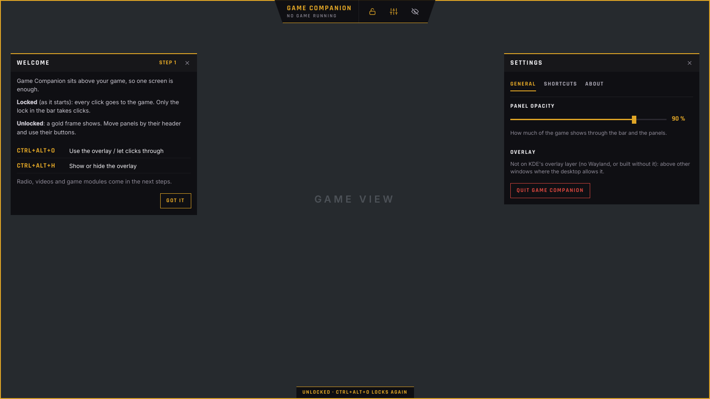

# Game Companion

One overlay for every game on Linux (Arch, KDE Plasma, Wayland), so one
screen is enough. It sits above the game; locked, every click goes through
to the game.



## What it does now (step 1: the core)

- **An overlay on KDE's overlay layer** (layer-shell): above games in
  fullscreen, borderless or windowed mode. Not inside Gamescope (Steam Deck
  mode), where no other overlay can show.
- **One lock.** Locked (as it starts), every click goes to the game and only
  the lock button in the bar takes clicks. Unlocked, a thin gold frame shows,
  panels move by their header and their buttons work; the overlay only takes
  the keyboard when you click into it.
- **Global shortcuts through KDE**, suggested as:
  - `Ctrl+Alt+O`: lock or unlock the overlay
  - `Ctrl+Alt+H`: show or hide the overlay

  Plasma asks once to confirm them. Change them in System Settings →
  Keyboard → Shortcuts → Game Companion.
- **The bar** at the top centre (the "Edge HUD" design): the name, the game
  module (none yet), lock, settings, hide.
- **Panels remember where they were left**; one opacity for the bar and all
  panels (Settings → General).
- **Nothing is sent.** The overlay works without the internet: the fonts ship
  with it, the shortcuts are local D-Bus. Anything that will go online comes
  only with the user's approval.

## Coming next

1. ~~Core: overlay, lock, shortcuts, bar, settings~~
2. Radio and streams (Twitch, YouTube, Jellyfin), moved over from the
   Clicktrough meter's plugins
3. Brave Origin and Legcord (on hold)
4. Game detection: start and close with a game (AION 2, Path of Exile 2)
5. The AION 2 module (first: start the Clicktrough meter with the game)

## Build and install (Arch)

```bash
git clone https://github.com/Xzero3007/Game-Companion.git
cd Game-Companion/packaging/arch
makepkg -si
```

Then start **Game Companion** from the application menu, or `game-companion`.
Each push to `main` also builds the package on GitHub (Actions → Build →
the run's artifact).

Needs: `qt6-base`, `qt6-declarative`, `qt6-wayland`, `layer-shell-qt`,
`xdg-desktop-portal` (and to build: `rust`, `clang`, `base-devel`).

### Development

```bash
cargo run                          # on KDE Wayland
cargo test
cargo build --no-default-features  # without layer-shell-qt (not above fullscreen games)
```

Screenshots without a desktop (the backdrop stands in for a game):

```bash
QT_QPA_PLATFORM=offscreen QT_QUICK_BACKEND=software GC_NO_SHORTCUTS=1 \
GC_DEMO=backdrop,unlocked,settings GC_SCREENSHOT=shot.png cargo run --no-default-features
```

`GC_DEMO` takes `backdrop`, `unlocked`, `settings`, `shortcuts`, `about`.

## How it is built

Qt 6 / QML for the interface, Rust for the logic, joined by
[CXX-Qt](https://github.com/KDAB/cxx-qt).

| Path | What |
|---|---|
| `src/companion.rs` | The overlay's state for QML: lock, shown, opacity, places, shortcuts |
| `src/settings.rs` | `~/.config/game-companion/settings.json` |
| `src/shortcuts.rs` | Global shortcuts through the GlobalShortcuts portal |
| `cpp/native.cpp` | The Qt app, KDE's overlay layer, the input region |
| `qml/` | The interface (Edge HUD design, colours in `qml/theme.js`) |
| `packaging/` | Desktop file and the Arch package |

## Licence

GPL-3.0-or-later (see `LICENSE`). Parts are adapted from the Clicktrough
meter (`Xzero3007/A2Tools-DPS-Meter_Clicktrough`, GPL-3.0).

Fonts: Rajdhani by the Indian Type Foundry and Inter by The Inter Project
Authors, both under the SIL Open Font License 1.1 (`assets/fonts/OFL-*.txt`).
