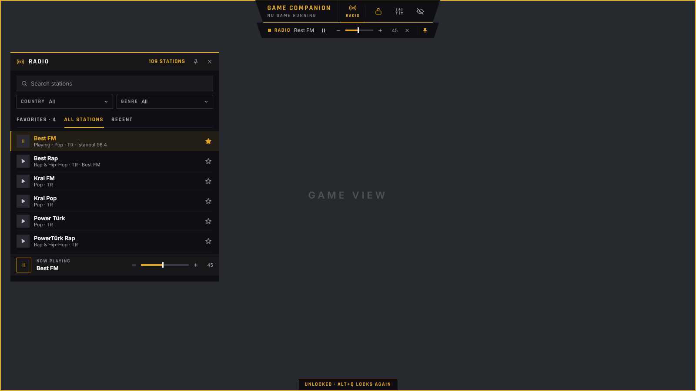

# Game Companion

One overlay for every game on Linux (Arch, KDE Plasma, Wayland), so one
screen is enough. It sits above the game; locked, every click goes through
to the game.



## What it does now

- **An overlay on KDE's overlay layer** (layer-shell): above games in
  fullscreen, borderless or windowed mode. Not inside Gamescope (Steam Deck
  mode), where no other overlay can show.
- **One lock.** Locked (as it starts), every click goes to the game and only
  the lock button in the bar takes clicks. Unlocked (the lock in the bar shows gold),
  panels move by their header and their buttons work; the overlay only takes
  the keyboard when you click into it.
- **Global shortcuts through KDE**, suggested as:
  - `Alt+Q`: lock or unlock the overlay
  - `Alt+Y`: hide or show the hub (pinned things stay)

  Plasma asks once to confirm them. Change them in System Settings →
  Keyboard → Shortcuts → Game Companion.
- **The bar** at the top centre (the "Edge HUD" design): the name, the game
  module (none yet), lock, settings, hide.
- **Panels remember where they were left and their size**: unlocked, the
  gold corner at a panel's bottom right makes it wider or narrower (the
  radio's list also taller); a double-click on it gives back its own size.
- **Display** (Settings → Display): one opacity for the bar and all panels,
  from solid down to 5 % (under half, text gets a dark outline); for the
  bar and the player row under it (panels stay as designed), the
  brightness of the white and grey text and of the gold, 100 down to
  40 %; the bar's size, 100 down to 60 % (with the player row). Opacity,
  text and gold each have three presets, P1 to P3: a click uses one, holding it or a right click keeps
  the current value there. Unlocked, the bar moves sideways when dragged
  by its name or its slanted ends; "Center bar" puts it back.
- **Light on the game.** Every part (the bar, the player row, each panel,
  each video) is a small window of its own on KDE's overlay layer, just as
  big as the part: nothing covers the rest of the screen, a playing video
  redraws only its own area, and nothing redraws while idle.
- **Layouts** (Settings → Layouts): save the arrangement under a name (which
  panels are open, where, how big, what is pinned, the opacity, the text
  and gold brightness, the bar's place and size), load it
  again with one click, rename or delete it.
- **Hide the hub, keep what you pin.** `Alt+Y` (or the eye in the bar)
  hides the bar and the panels; anything pinned (the pin in a panel's header,
  or at the end of the player row) stays on screen.
- **Radio** (the bar's Radio button): 109 stations by country and genre,
  favourites, recent, search, Best FM first. Played by your **mpv** in the
  background, so it plays on with the panel closed or the hub hidden. Only
  the stations' own stream servers are played (a built-in list, checked
  before every address). The station list comes from the Clicktrough Radio
  plugin (`Xzero3007/A2Tools-Clicktrough-Plugins`, GPL-3.0); refresh it with
  `node dev/stations-from-plugin.mjs <plugins/radio/stations.js>`.
- **Player row** under the bar while the radio plays: state, pause, volume
  as one bar (− and + step by 5, a click on the bar sets it, the wheel
  steps), stop.
- **Streams** (the bar's TV button): **Twitch** (the game's category, the
  channels you follow once signed in, your favorites with the star, all
  live, a search) and **YouTube** (the game's newest videos, your
  subscriptions from FreeTube's file and channels you keep with the star,
  one channel's videos, a search; a pasted link plays at once). The game's
  preset comes first under its purple tag (AION 2 until game detection;
  CHANGE sets another). Following shows every channel you follow, the live
  ones first. Every list shows as tiles side by side (two to four a row, as
  wide as the panel is) or as rows; the arrows, the mouse's side buttons and
  Alt+Left / Alt+Right go back and forth through tabs, lists, searches and
  channels. Subscriptions load several channels at once, show while they
  come, and are kept 15 minutes (the refresh button asks again). Moved over from the Clicktrough meter's Streams
  plugin (`Xzero3007/A2Tools-Clicktrough-Plugins`, GPL-3.0).
- **Videos over the game**: a click plays it in Twitch's, YouTube's or
  Jellyfin's own window (all at once if you like), drawn by your **libmpv** into the
  overlay. Locked, clicks go through it; unlocked, the pointer on it shows
  its bars (pin, quality from a list: source, 1080p to 360p or sound only;
  full screen (Esc leaves it); close; pause, 10 seconds back and on, a time
  line to click or drag, volume, opacity from a list, 100 to 50 % in steps
  of 10, kept for each window), it moves by dragging and grows by the corner (16:9).
  Pinned, it stays while the hub is hidden. The player row gets a part for
  each video. Twitch plays through **Streamlink** when installed (no ad
  breaks; signed in, Turbo or a subscription means no ads at all), else
  through yt-dlp; YouTube through yt-dlp. A video that doesn't play says
  why in yt-dlp's or mpv's words, with a hint where one is known.
  When the time stands still for 4 seconds while it should play (after a
  jump, a quality change, a stalled connection), it gets a fresh address
  and goes on at the same spot ("Reconnecting…").
- **What Streams sends**: Twitch's public API (gql.twitch.tv, fixed
  queries; your twitch.tv token only for the followed channels, to Twitch
  alone, kept in `~/.config/game-companion/twitch.json`, readable by you
  only), YouTube's channel feeds, YouTube's search and the videos through
  yt-dlp, and the thumbnails of static-cdn.jtvnw.net, i.ytimg.com and
  yt3.ggpht.com (the app's image loader refuses every other host), and
  SponsorBlock (sponsor.ajay.app) when switched on in Settings → Streams,
  asked with only the first four characters of the video id's SHA-256;
  and your own Jellyfin server in your home network. Nothing else.
- **Jellyfin, your own server, in your home network only.** Sign in once
  (Settings → Streams → Jellyfin, or the Streams panel's Jellyfin tab) with
  the server's address, your name and password: only a home network's
  address is taken (192.168.x.x, 10.x.x.x, 172.16-31.x.x, localhost,
  fe80::/fc00:: or a name like `nas.local` that leads only to such
  addresses); anything else is refused before it is tried. The password is
  never kept; the server's key is, in `~/.config/game-companion/jellyfin.json`,
  readable by you only. Every request goes through curl with the checked
  address pinned, no proxy, no redirects and no `~/.curlrc`; the key goes in
  a header on stdin, never in an address or the process list. The tab
  shows Continue, Next up, your libraries (films, shows, seasons; more as
  you scroll) and a search, with the server's pictures (fetched by the app,
  kept in memory only) and how far each one is watched; a check mark marks
  it watched or not. It plays in its own video window: the file as it is
  (ORIGINAL) or the server's conversion down to 1080p to 360p, from where
  you left it, with its sound tracks and subtitles (also the server's own
  subtitle files), SKIP INTRO / SKIP CREDITS where the server knows them
  (Media Segments or the Intro Skipper plugin; by themselves if you like),
  and the next episode of a show after five seconds. mpv plays it without
  yt-dlp, without scripts and without a proxy. Your server hears what plays
  and how far every 10 seconds, so Continue watching is right in every
  Jellyfin app. Sign out tells the server to forget the key and deletes it
  here. Ported from the Clicktrough meter (patch 0053) and its Streams plugin.
- **Hardware decoding** (Settings → Streams → Videos, on by default): the
  graphics card unpacks videos (less work for the processor, a few hundred
  MB of video memory for a stream); off, the processor does it.
- **SponsorBlock** (off until switched on): the parts of YouTube videos
  viewers flagged are marked on the time line in their colour; each
  category skips, shows or is off (FreeTube's choices can be taken over).
  A skip says so, with UNDO. Segments: SponsorBlock, CC BY-NC-SA 4.0.
- **Updates from its own releases.** At the start, every 20 minutes and with
  Settings → General → Check for updates, it reads `latest.json` of this
  repo's latest GitHub release. A newer one shows a gold **Update** button in
  the bar: it downloads the package, checks its SHA-256, installs it (through
  pkexec, without a password by the package's own root script, which checks
  the checksum again itself; with the password if that is missing) and starts
  again. Only a copy installed by pacman updates itself this way.
- **Turn off** in Settings → General closes the whole app, with the radio.
- **Nothing else goes online.** The fonts ship with the app, the shortcuts
  are local D-Bus; the only network use is the radio stream you pick, the
  streams you open, your Jellyfin server at home, and the update check on GitHub.

## Coming next

1. ~~Core: overlay, lock, shortcuts, bar, settings~~
2. ~~Radio~~, ~~streams (Twitch, YouTube, Jellyfin)~~ with a preset search per game
3. Brave Origin and Legcord (on hold)
4. Game detection: start and close with a game (AION 2, Path of Exile 2),
   and a Games tab that lists the Steam, Lutris and Heroic games and starts them
5. The AION 2 module (first: start the Clicktrough meter with the game)

## Build and install (Arch)

```bash
git clone https://github.com/Xzero3007/Game-Companion.git
cd Game-Companion/packaging/arch
makepkg -si
```

Then start **Game Companion** from the application menu, or `game-companion`.
Each push to `main` also builds the package on GitHub and publishes it as a
release (with `latest.json`, the update check's manifest). Installing a
release package (`sudo pacman -U game-companion-*.pkg.tar.zst`) works too;
after that the app updates itself.

Needs: `qt6-base`, `qt6-declarative`, `qt6-wayland`, `layer-shell-qt`,
`qt6-svg`, `xdg-desktop-portal`, `polkit`, `curl`; `mpv` for the radio and the videos, `yt-dlp` for YouTube, `streamlink` for Twitch without ad breaks (and to build: `rust`, `clang`,
`base-devel`).

### Development

```bash
cargo run                          # on KDE Wayland
cargo test
cargo build --no-default-features  # without layer-shell-qt (not above fullscreen games)
```

Screenshots without a desktop (the backdrop stands in for a game):

```bash
QT_QPA_PLATFORM=offscreen QT_QUICK_BACKEND=software GC_NO_SHORTCUTS=1 \
GC_DEMO=backdrop,unlocked,settings GC_SCREENSHOT=shot.png cargo run --no-default-features
```

`GC_DEMO` takes `backdrop`, `unlocked`, `settings`, `shortcuts`, `about`,
`radio`, `radio-playing`, `hidden`.

## How it is built

Qt 6 / QML for the interface, Rust for the logic, joined by
[CXX-Qt](https://github.com/KDAB/cxx-qt).

| Path | What |
|---|---|
| `src/companion.rs` | The overlay's state for QML: lock, shown, opacity, places, shortcuts |
| `src/settings.rs` | `~/.config/game-companion/settings.json` |
| `src/shortcuts.rs` | Global shortcuts through the GlobalShortcuts portal |
| `src/radio.rs`, `src/radio_object.rs` | Stations, the radio's network guard, the mpv player, the `Radio` QML singleton |
| `data/stations.json` | The station list |
| `cpp/native.cpp` | The Qt app; each part's window on KDE's overlay layer, its place and where it takes clicks |
| `qml/Surface.qml` | One part of the overlay in a window of its own, as big as the part |
| `qml/` | The interface (Edge HUD design, colours in `qml/theme.js`) |
| `packaging/` | Desktop file and the Arch package |

## Licence

GPL-3.0-or-later (see `LICENSE`). Parts are adapted from the Clicktrough
meter (`Xzero3007/A2Tools-DPS-Meter_Clicktrough`, GPL-3.0).

Fonts: Rajdhani by the Indian Type Foundry and Inter by The Inter Project
Authors, both under the SIL Open Font License 1.1 (`assets/fonts/OFL-*.txt`).
